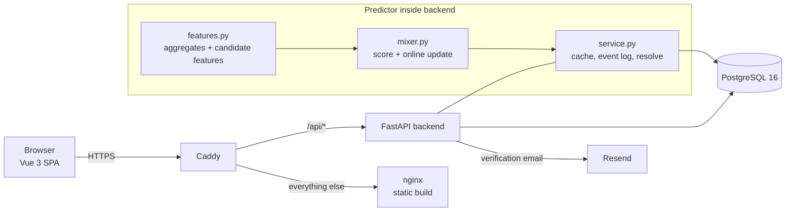
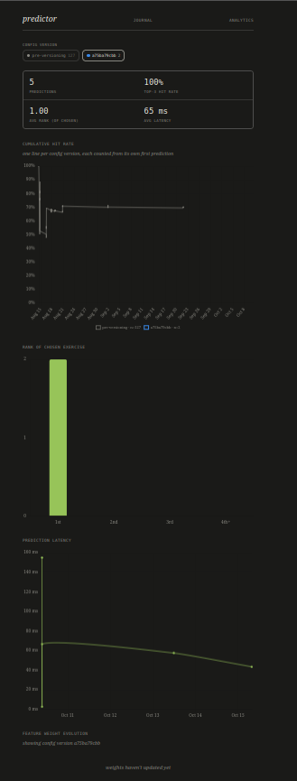

# journal

[](https://github.com/pkhleb/journal/actions/workflows/deploy.yml)

A full-stack personal journal and tracker with a **next-exercise recommender** that is built, evaluated, and monitored like a small production ML system: walk-forward backtesting, versioned model configs, a prediction/outcome event log, and an in-app monitoring dashboard.

**Live:** [journal.pkhleb.com](https://journal.pkhleb.com) (sign-in requires email verification)

**Stack:** FastAPI · async SQLAlchemy · PostgreSQL (JSONB) · Alembic · NumPy · Vue 3 · Pinia · Chart.js · Docker Compose · Caddy · GitHub Actions

---

## What it does

Users write entries that combine free text with a typed metric (weight, exercise, sleep quality, or a meal). Meals can also be saved to an inventory and "consumed" into a meal entry.

The ML lives in exercise logging. When a user picks the exercise metric, the exercise field is ranked by how likely each known exercise is to be the *next* one, given what has already been logged in the current session. Each prediction is later resolved against what the user actually chose, which drives both per-user online learning and a monitoring dashboard.

## What this project demonstrates

| Area | What's here | Where to look |
|---|---|---|
| **ML modeling** | Feature-engineered ranking model with five signals, sparse-data backoff, and a pairwise-ranking online update with L2 regularization toward a prior | [`backend/app/predictor/`](backend/app/predictor) |
| **Experimentation** | Walk-forward backtester with no lookahead, ablations, hyperparameter sweeps, chronological held-out validation scripts, 39 saved result files | [`backend/experiments/`](backend/experiments) |
| **MLOps** | Config fingerprinting, feature-set signatures that invalidate stale learned weights, per-prediction event logging, latency tracking, a version-aware monitoring UI | [`config.py`](backend/app/predictor/config.py), [`service.py`](backend/app/predictor/service.py), [`PredictorView.vue`](frontend/src/views/PredictorView.vue) |
| **Backend** | Async FastAPI, JWT auth, bcrypt, email verification, login lockout, rate limiting, per-user data scoping, admin-only routes, Alembic migrations | [`backend/app/`](backend/app) |
| **Testing** | 35 async integration tests against a real PostgreSQL, including regression tests written from a production incident | [`backend/tests/`](backend/tests) |
| **DevOps** | Test → build → push → deploy pipeline, containerized services behind Caddy with automatic HTTPS | [`.github/workflows/deploy.yml`](.github/workflows/deploy.yml), [`docker-compose.yml`](docker-compose.yml) |
| **Frontend** | Vue 3 SPA with route guards, a Pinia store, and Chart.js dashboards | [`frontend/src/`](frontend/src) |

## Architecture



**Data model.** `users`, `entries` (prose plus `metric_type` and a JSONB `metric_data`), `inventory`, `model_weights` (one learned weight vector per user), and `prediction_events` (a JSONB record of every prediction and its outcome).

## The prediction system

### Problem

Given the sets already logged today and the last exercise, rank the user's known exercises so the one they log next lands near the top. Quality is measured with **top-1 accuracy**, **top-3 hit rate** (the UI surfaces a short list), and **mean reciprocal rank (MRR)**.

### Features

Each candidate exercise gets a feature vector. Five are live in production ([`config.py`](backend/app/predictor/config.py)):

| Feature | Meaning |
|---|---|
| `transition` | P(next \| last exercise), from adjacent-set counts within past sessions |
| `phase_transition` | Same, but bucketed by session phase (first 15 sets vs. later). Backs off to `transition` when a bucket has fewer than 2 observations, so sparse data adds no noise |
| `weekday` | How often the exercise appears on this day of the week |
| `position_freq` | How often the exercise occurs at this exact position in a session |
| `recency` | Exponential decay on days since last seen (21-day time constant) |

A sixth signal, `session_precedence` (order-independent "how often does X eventually follow what I've already done today"), is implemented in `features.py` but deliberately excluded from production. Per the comments in `config.py`, it did not validate on held-out data.

### Scoring and online learning

Scores are a weighted sum of features ([`mixer.py`](backend/app/predictor/mixer.py)). Weights start from hand-tuned defaults. When a user logs an exercise, the system resolves the earlier prediction and, on a **miss** (chosen exercise outside the top 3), applies a structured-perceptron-style pairwise update: push weight away from features where the top-ranked "violators" beat the chosen exercise, with an L2 term pulling back toward the prior. An `always` mode that also updates on hits is implemented for comparison.

### Production serving and instrumentation

[`service.py`](backend/app/predictor/service.py) is the single entry point routers call.

- **Two-tier compute.** The expensive part (one query plus O(n) aggregation over a user's history) is cached per user per day and invalidated whenever an exercise is logged. The cheap part (scoring from in-memory aggregates) runs on each request, so it is safe to call on every keystroke.
- **One event per live prediction.** Repeated calls refresh the open `prediction_events` row in place instead of inserting a new row per keystroke. If a set is logged against a prediction more than 45 minutes old, the event is closed as `stale` with no model update, and the dashboard excludes stale events from its metrics.
- **Full event record.** Each event stores the candidate feature vectors, the ranking, the weights used, the chosen exercise, its rank, hit/miss, weights before and after any update, and `latency_ms`. Any past prediction can be re-scored or audited.
- **Config versioning.** `CONFIG_VERSION` is a hash of the feature list, default weights, and phase parameters, stamped on every event so a metric shift can be tied to a deploy. The dashboard plots hit rate per config version.
- **Feature-set signatures.** Learned weights are stored with a signature of the feature set they were trained under, and are ignored (defaults served) on mismatch. This came from a real incident: a user's weight row written before two features existed was served as-is, silently scoring the new features at weight 0 and running a model nobody had validated. The fix has regression tests ([`TestPredictorWeightsCompatibility`](backend/tests/test_predictor.py)).
- **Monitoring UI.** The predictor page shows cumulative hit rate by config version, rank distribution, latency over time, and feature-weight evolution.



## Experiments

### Method ([`backtest.py`](backend/experiments/backtest.py))

A walk-forward harness replays one user's history in order. At each logged set it predicts using only data from strictly before that set, scores the result, lets the model update, and only then folds the set into the running state. Scoring (`build_candidates`) and the learning update (`apply_ranking_update`) are the same functions production calls, so a model that wins offline behaves the same live. Aggregate bookkeeping is mirrored incrementally in the harness, which keeps replay O(n) rather than re-querying the database at every step.

Data: the author's own training log of 969 exercise sets, of which **936 are scoreable** (an exercise must have been seen before it can be predicted).

Scripts, all runnable as `python -m experiments.<name> <email>`:

| Script | Purpose |
|---|---|
| `run`, `compare` | Run and tabulate every model variant; saves JSON results |
| `signals_validate`, `phase_validate` | Chronological held-out validation: score configs only on the later split (`phase_validate` also tunes on the earlier one) |
| `phase_sweep`, `weight_sweep` | Grid search over phase parameters; Dirichlet random search over feature weights |
| `single_feature`, `pairwise_features`, `feature_correlation` | Solo power, complementarity, and redundancy of features |
| `phase_support_check` | How often phase-specific data is dense enough to be used at all |
| `diagnose` | Learning-rate / L2 grids and first-half vs. second-half comparison for the online learner |

### Results

Latest saved run (`20260817T225151Z`), full-history walk-forward, n = 936:

| Model | Top-1 | Top-3 | MRR |
|---|---|---|---|
| Baseline: transition + weekday + recency (static) | 48.1% | 69.3% | 0.611 |
| + phase-aware transitions | 49.4% | 69.6% | 0.618 |
| + position frequency | 49.7% | 70.6% | 0.622 |
| + session precedence | 49.1% | 70.0% | 0.618 |
| **All signals combined (static weights)** | **51.5%** | **71.5%** | **0.638** |
| Online mixer, miss-only updates | 46.6% | 67.7% | 0.598 |
| Online mixer, update on every prediction | 43.9% | 64.4% | 0.568 |

The "all signals" row was run with a six-feature set that still included `session_precedence`. An earlier run (`20260817T224032Z`) of phase + position alone, which matches the current production feature set, scored 50.3% / 71.8% / 0.633. Configs changed between runs, so cross-run comparisons are loose.

### What the results say

1. **Added signals help modestly, and mostly in combination.** Each signal alone moves top-3 by under 1.5 points. Combined, the gain is about 2 points top-3 and 3 points top-1 over baseline. A top-3 rate at this sample size has a standard error of roughly ±1.5 points, so these are directional, not statistically conclusive.
2. **The online learner underperformed static weights, consistently.** Across all 9 saved runs (6 distinct configurations), the miss-only mixer scored below every static configuration in the same run, trailing the best one by 3.3 to 6.0 points top-3, and the always-update mode was worse than miss-only every time. The gap exceeds the standard error and appears under every configuration, so it is unlikely to be noise, though all runs share one dataset.
3. **A lead on why.** In every saved mixer run the learned weights sum to between 0.003 and 0.18, against about 1.0 for the defaults. That suggests the update shrinks all weights rather than reallocating among them. This is a hypothesis, not a confirmed cause. `diagnose.py` (learning-rate and L2 grids, first-half vs. second-half comparison) exists to test it, but its output was not saved; normalizing or projecting the weight vector is the obvious next experiment.

### Caveats

- **Single-user dataset.** Results describe the author's own training log and may not transfer to other people.
- **Optimistic selection.** Phase cutoff, support threshold, and default weights were chosen using this same history. Chronological held-out validation scripts are included, but their outputs were not committed, so the table above reports only the full-history walk-forward numbers.
- **Production still applies the online update.** The deployed service uses the miss-only update that these backtests show underperforming static weights; see Limitations.

## Backend engineering

- **API.** Async FastAPI with Pydantic v2 schemas. Routers for users, entries (CRUD + JSON export), inventory, predictor metrics, and an admin-only activity feed that returns zero-filled weekly/monthly aggregates (no per-user data).
- **Auth and abuse protection.** bcrypt password hashing, JWT bearer tokens (30-day expiry), email verification via 24-hour single-use tokens, account lockout (15 minutes after 5 failures), and per-route rate limits with `slowapi`. Every query is scoped to the authenticated user, and a test asserts the metrics endpoint cannot leak another user's events.
- **Migrations.** Alembic runs on container start ([`entrypoint.sh`](backend/entrypoint.sh)).
- **Config.** Secrets and connection strings come from environment variables; CORS is restricted to the production origin.

## Testing

35 async integration tests (`pytest` + `pytest-asyncio` + `httpx`) run against a real PostgreSQL 16, with the email sender mocked and tables cleaned between tests.

| Suite | Tests | Covers |
|---|---|---|
| `test_predictor.py` | 17 | Endpoint wiring; hit vs. miss update behavior; stale and unmatched events; latency capture; feature-signature compatibility; config-version stamping; cross-user isolation. Time is frozen so outcomes don't depend on the calendar. |
| `test_auth.py` | 10 | Registration conflicts, verification gating, wrong password, lockout, protected routes |
| `test_activity.py` | 7 | Admin gating; weekly/monthly bucketing with zero-fill and year-boundary handling |
| `test_health.py` | 1 | Health endpoint |

There are no frontend tests yet.

## CI/CD and deployment

On every push to `main` ([`deploy.yml`](.github/workflows/deploy.yml)):

1. **Test.** The backend suite runs against a Postgres 16 service container.
2. **Build and push.** The backend image is built and pushed to GitHub Container Registry, tagged `latest` and by commit SHA.
3. **Deploy.** The Vue app is built in CI and copied to the server, which pulls the new backend image and restarts the stack with `docker compose`.

Production runs as Docker Compose services (PostgreSQL, backend, nginx for the static frontend, and Caddy for routing and automatic HTTPS).

## Running it locally

Requires Docker with Compose v2.24+. No `.env`, no manual database setup:

```bash
git pull
docker compose up
```

| | |
|---|---|
| App (Vite, hot reload) | http://localhost:5173 |
| API docs | http://localhost:8000/docs |
| Dev login | `dev@local.dev` / `devpassword123` (verified, admin) |
| Dev database | `localhost:5432` (persisted in a volume) |
| Test database | `localhost:5434` (throwaway, no volume) |

`docker-compose.override.yml` is merged automatically and adds the dev-only pieces: a bind-mounted backend running `uvicorn --reload`, a Vite dev server proxying `/api` to the backend, and a test database. On startup [`dev_bootstrap.py`](backend/dev_bootstrap.py) prepares the dev database: the baseline Alembic migration is an empty stamp of a pre-existing schema, so on a fresh database it creates the tables from the models and stamps `head`; on an existing one it runs `alembic upgrade head`. It also seeds the dev user. Caddy is skipped locally.

**Run the backend tests** (the test database is already up):

```bash
docker compose exec backend pytest tests/ -v
```

**Run the experiments** against a scratch database (`journal_exp`, separate from the app's), loaded from a JSON export of your account:

```bash
cp ~/Downloads/export.json backend/export.json            # git-ignored
docker compose run --rm experiments setup                 # (re)creates journal_exp and loads the export
docker compose run --rm experiments signals_validate      # any module in backend/experiments/
```

Re-run `setup` to refresh from a newer export. The scripts run as `test@local.dev`, the user `import.py` creates.

**Reset the dev database:** `docker compose down -v`, then `docker compose up`.

**Production** uses only `docker-compose.yml`; the deploy workflow passes `-f docker-compose.yml` so the override is never merged. Do the same if you run compose by hand on the server.

Sending a real verification email needs `RESEND_API_KEY` (set it in your shell or a git-ignored `.env`). To load real data locally, [`import.py`](backend/import.py) seeds a pre-verified user (`test@local.dev`, password `testpassword123`) from a JSON export produced by the app's `/api/export/db` endpoint: `docker compose exec backend python import.py export.json`.

**Run the experiments** against a database containing an exercise history:

```bash
cd backend
python -m experiments.run you@example.com        # all model variants -> experiments/results/
python -m experiments.compare                    # tabulate saved runs (--all for every file)
python -m experiments.signals_validate you@example.com
```

## Limitations and next steps

- **Fix or gate the online learner.** The deployed update rule is the one that underperforms in backtests. Next steps: normalize or project the weight vector after each update, test a decayed or batched learner, or serve static weights and log updates in shadow mode so live data can arbitrate.
- **Commit held-out validation outputs** so the claims above rest on out-of-sample numbers, not just walk-forward ones.
- **Bootstrap a fresh database from migrations.** The baseline migration should create the schema so `alembic upgrade head` works from empty.
- **Multi-replica serving.** The per-day aggregate cache is in-process, which assumes one backend replica. Horizontal scaling would need a shared cache such as Redis.
- **CI on pull requests.** The workflow currently runs on pushes to `main` only.
- **Frontend tests.** Vitest and Vue Test Utils are installed, but there are no test files yet.
- **Dev ergonomics.** There is no Vite dev proxy configured, so running the frontend locally takes the extra step described above.

## Repository layout

```
backend/
  app/
    predictor/      config.py  features.py  mixer.py  service.py
    routers/        users  entries  inventory  predictor  activity
    models.py  schemas.py  auth.py  limiter.py  email.py  database.py
  alembic/          migrations
  experiments/      backtest harness, sweeps, validation, saved results/
  tests/            35 integration tests
frontend/src/       views/  components/  stores/  router/
.github/workflows/  deploy.yml
docker-compose.yml  Caddyfile
```
